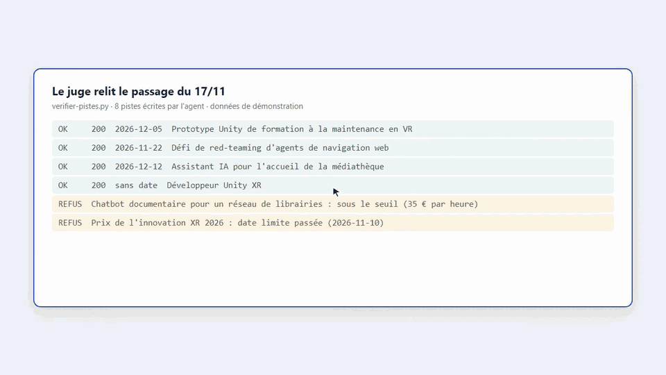

[English](README.md) · **Français**

# opportunity-scout

**Chaque matin, un agent Claude Code cherche du travail payé sur le web ; un simple script recontrôle chaque piste avant qu'elle n'arrive dans votre liste.**

[](https://drive.google.com/file/d/1JvPLCW5v554LGiX6XDvAgMzJfXQjS-YM/view)

*L'app de ce dépôt sur des données de démonstration : le juge contrôle le passage du jour (4 pistes gardées sur 8), les pistes de la semaine sont triées, puis le récapitulatif du lundi précédent. [Vidéo complète (1:19)](https://drive.google.com/file/d/1JvPLCW5v554LGiX6XDvAgMzJfXQjS-YM/view)*

## Ce qu'on fait avec

- **Passage quotidien.** À 7 h, `lancer.sh` (cron) lance `claude -p`. Il cherche des contrats (missions freelance, marchés publics), des concours et du red-teaming, et des emplois, selon la répartition de l'effort que vous fixez (60 / 20 / 20 par défaut).
- **Ce qui est écarté.** `verifier-pistes.py` écarte une piste à laquelle il manque un champ, dont la date limite est passée, dont le montant est sous votre seuil, un emploi ni dans vos villes ni en télétravail complet, un lien en erreur, ou une page d'emploi ou de mission qui dit l'offre close.
- **Trier dans l'app.** Les pistes par catégorie, chacune marquée *à voir*, *intéressé* ou *écarté* d'un clic. L'app garde ce tri ; l'agent le lit le lendemain matin, avec la consigne de ne plus reproposer ce que vous avez écarté.
- **Vos réglages.** Onglet Sources pour ajouter des sites ; onglet Profil pour les seuils, les villes, la répartition et le texte qui vous décrit. L'agent a pour consigne de ne jamais mettre ce texte dans une recherche web, de ne créer aucun compte et de ne candidater à rien.
- **Récapitulatif du lundi.** Les pistes de la semaine, recontrôlées par script le matin même, ordonnées par un second passage de l'agent, en newsletter HTML lisible dans les messageries. Rien ne part tant que le fichier `.envoi-actif` n'existe pas.

## Architecture


## Démarrage

```bash
git clone https://github.com/anthohunt/opportunity-scout && cd opportunity-scout
cp docker-compose.example.yml docker-compose.yml
mkdir data && sudo chown 1000:1000 data            # le conteneur tourne en uid 1000
cp agent/contexte.exemple.md data/contexte.md      # puis décrivez-vous, ou passez par l'onglet Profil
docker compose up -d --build
docker compose exec scout python manage.py masterpw   # affiche le mot de passe maître une seule fois
```

Ouvrez http://localhost:8000. Pour l'agent : `cp .env.example .env`, mettez dans `SCOUT_DIR` le chemin absolu de `data/`, chargez-le (`set -a; . ./.env; set +a`), puis `FORCE=1 agent/lancer.sh` fait un passage tout de suite et `FORCE=1 HEBDO=1 agent/lancer.sh` rend le récapitulatif du lundi sans l'envoyer. Lancez-les depuis le dossier du dépôt (l'import appelle `docker compose`).

<details><summary>Prérequis, tests, sources</summary>

- **Prérequis.** L'app : Docker avec l'extension compose, ou Python 3.10 ou plus (`pip install -r requirements.txt`). La machine qui lance `lancer.sh` : `python3`, `perl`, `flock`, `date` GNU et [Claude Code](https://code.claude.com/docs/fr/overview) connecté ; sans Claude Code, l'app et le juge tournent, mais ni recherche ni récapitulatif.
- **Tests.** `docker compose run --rm scout python -m pytest -q tests` : 13 tests sur une vraie base SQLite et un vrai serveur HTTP local.
- **Sources.** Pages et API publiques (BOAMP, TED, Devpost…). Respectez les conditions de chaque site et gardez un faible volume ; les sites qui bloquent les robots (Malt, Upwork, Indeed) passent par la recherche web.
- **Langue.** Les consignes de l'agent et l'app sont en français ; adaptez `agent/sources-base.md` et le profil d'exemple à votre marché.

</details>

## État

- **En usage depuis octobre 2026.** La copie de l'auteur tourne chaque matin. Elle a dépassé ce dépôt (subventions, mail quotidien, compteur d'effort, règle de distance) et n'est pas publiée.
- **Ce dépôt** est la première version publique (26 octobre 2026), dépendances mises à jour le 10 novembre.
- **Licences.** Code sous Apache 2.0 (`LICENSE`, `NOTICE`) ; documentation et consignes de l'agent sous CC BY 4.0 (`LICENSE-docs`). Le profil d'exemple est inventé.

---

**Anthony Hunt** · [ingevision.cloud](https://ingevision.cloud/?p=opportunity-scout) · [LinkedIn](https://www.linkedin.com/in/anthony-hunt-3948a9196) · [GitHub](https://github.com/anthohunt)
