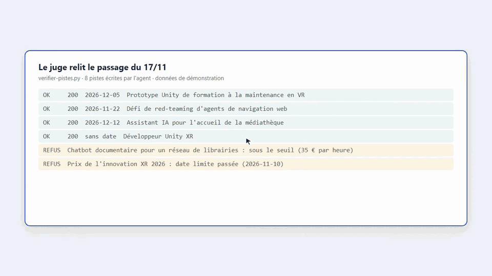

**English** · [Français](README.fr.md)

# opportunity-scout

**Every morning a Claude Code agent searches the web for paid work; a plain script re-checks every lead before it reaches your list.**

[](https://drive.google.com/file/d/1JvPLCW5v554LGiX6XDvAgMzJfXQjS-YM/view)

*The app from this repository on demo data: the judge checks today's pass (4 leads kept out of 8), the week's leads are sorted, then last Monday's digest. [Full video (1:19)](https://drive.google.com/file/d/1JvPLCW5v554LGiX6XDvAgMzJfXQjS-YM/view)*

## Using it

- **Daily pass.** At 7 a.m. `lancer.sh` (cron) starts `claude -p`. It searches contracts (freelance missions, public tenders), competitions and red-teaming, and jobs, with the effort split you set (60 / 20 / 20 by default).
- **What it drops.** `verifier-pistes.py` drops a lead with a missing field, a past deadline, an amount under your threshold, a job neither in your cities nor fully remote, a link that fails, or a job or mission page that says the offer is closed.
- **Sort in the app.** Leads by category, each marked *to see*, *interested* or *dismissed* in one click. The app keeps your triage; the agent reads it the next morning and is told not to propose what you dismissed again.
- **Your settings.** Sources tab for sites to add; Profile tab for thresholds, cities, effort split and the text that describes you. The agent is instructed never to put that text into a web search, create an account or apply to anything.
- **Monday digest.** The week's leads, re-checked by script that morning, ordered by a second agent pass, rendered as an email-safe HTML newsletter. Nothing is sent until you create `.envoi-actif`.

## Architecture


<details><summary>French version</summary>


</details>

## Quick start

```bash
git clone https://github.com/anthohunt/opportunity-scout && cd opportunity-scout
cp docker-compose.example.yml docker-compose.yml
mkdir data && sudo chown 1000:1000 data            # the container runs as uid 1000
cp agent/contexte.exemple.md data/contexte.md      # then describe yourself, or use the Profile tab
docker compose up -d --build
docker compose exec scout python manage.py masterpw   # prints the master password once
```

Open http://localhost:8000. For the agent: `cp .env.example .env`, set `SCOUT_DIR` to the absolute path of `data/`, load it (`set -a; . ./.env; set +a`), then `FORCE=1 agent/lancer.sh` runs one pass now and `FORCE=1 HEBDO=1 agent/lancer.sh` renders the Monday digest without sending it. Run both from the repository folder (the import command calls `docker compose`).

<details><summary>Requirements, tests, sources</summary>

- **Requirements.** The app: Docker with the compose plugin, or Python 3.10 or later (`pip install -r requirements.txt`). The machine that runs `lancer.sh`: `python3`, `perl`, `flock`, GNU `date` and [Claude Code](https://code.claude.com/docs/en/overview) logged in; without Claude Code, the app and the judge still run, but no search and no digest.
- **Tests.** `docker compose run --rm scout python -m pytest -q tests`: 13 tests on a real SQLite base and a real local HTTP server.
- **Sources.** Public pages and APIs (BOAMP, TED, Devpost…). Respect each site's terms and keep the volume low; sites that block robots (Malt, Upwork, Indeed) are reached through web search.
- **Language.** The agent instructions and the app are in French; adapt `agent/sources-base.md` and the example profile to your market.

</details>

## Status

- **In use since October 2026.** The author's own copy runs every morning. It has grown past this repository (subsidies, a daily mail, an effort counter, a distance rule) and is not published.
- **This repository** is the first public version (26 October 2026), with dependencies updated on 10 November.
- **Licences.** Code under Apache 2.0 (`LICENSE`, `NOTICE`); documentation and agent instructions under CC BY 4.0 (`LICENSE-docs`). The example profile is fictional.

---

**Anthony Hunt** · [ingevision.cloud](https://ingevision.cloud/?lang=en&p=opportunity-scout) · [LinkedIn](https://www.linkedin.com/in/anthony-hunt-3948a9196) · [GitHub](https://github.com/anthohunt)
